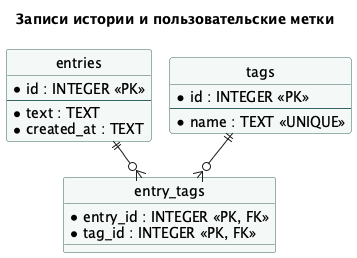

# Модель данных истории буфера обмена

За одно копирование приложение создаёт одно событие с идентификатором, полным текстом и временем. Два несмежных копирования одного текста остаются разными событиями. В версии из исходников пользователь может назначить записи несколько меток, а одну метку использовать для разных записей. Каждая история принадлежит локальному профилю ОС. Подтверждение предупреждения хранится в settings.json, текущая версия системного буфера — в памяти процесса.



## От исходной записи к первой нормальной форме

В плоском представлении строка «2 | Согласовать время доставки | 09:10 | Работа, Доставка» смешивает событие и набор меток. Поиск одной метки потребовал бы разбирать строку, а переименование — исправлять все совпадения. Если отвести отдельную строку каждому назначению, текст и время события будут повторяться. При удалении последнего назначения можно потерять само событие.

Переход к 1НФ даёт одну строку на пару «запись, метка». Значения текста и времени остаются атомарными, включая текст с переносами строк. Список меток в одной ячейке исчезает.

## Вторая нормальная форма

В промежуточной таблице с ключом (entry_id, tag_id) зависимость entry_id → text, created_at относится только к первой части ключа. Зависимость tag_id → name относится только ко второй. Выделяем entries и tags. В entry_tags остаются только два внешних ключа. Составной первичный ключ запрещает повторное назначение одной метки записи.

## Третья нормальная форма

В entries оба неключевых атрибута определяются идентификатором события. Текст не определяет время, а время не определяет текст. В tags идентификатор и уникальное название — потенциальные ключи. Название хранится один раз, транзитивной зависимости через tag_id в записях нет. В entry_tags отсутствуют неключевые атрибуты. Таблицы удовлетворяют 3НФ.

| Таблица | Ограничения | Назначение |
| --- | --- | --- |
| entries | id — целочисленный PK, text и created_at обязательны | Текст размером от 1 до 1 048 576 байт UTF-8. Время содержит смещение часового пояса. Порядок списка определяет id. |
| tags | id — PK, name — UNIQUE | Названия длиной до 40 символов. Регистр значим. |
| entry_tags | PK (entry_id, tag_id), два FK с ON DELETE CASCADE | От нуля до нескольких меток у каждой записи. Приложение ограничивает ввод двенадцатью метками. |

Префикс составного ключа обслуживает чтение меток одной записи. Обратный индекс ix_entry_tags_tag(tag_id, entry_id) обслуживает выборку записей по метке. При удалении записи или вытеснении её по лимиту 500 строк каскад снимает назначения. Триггер удаляет название, когда исчезает последняя ссылка на него.

## Проверка на демонстрационной базе

Из корня репозитория откройте SQLite в памяти. Все данные примера вымышлены. В приложении внешние ключи включаются на каждом соединении.

```sh
sqlite3 :memory:
```

```sql
PRAGMA foreign_keys = ON;
.read database/schema.sql
.read database/seed_data.sql
SELECT e.id, t.name FROM entry_tags et
JOIN entries e ON e.id = et.entry_id JOIN tags t ON t.id = et.tag_id
ORDER BY e.id, t.id;
EXPLAIN QUERY PLAN SELECT entry_id FROM entry_tags WHERE tag_id = 1;
DELETE FROM entries WHERE id = 2;
SELECT name FROM tags ORDER BY name;
PRAGMA foreign_key_check;
```

Первый запрос возвращает (1, Работа), (2, Работа), (2, Доставка). SQLite выбирает покрывающий индекс ix_entry_tags_tag. После удаления записи 2 сохраняется метка «Работа» у записи 1. Проверка внешних ключей возвращает ноль строк.

## Совместимость

Релиз 1.0.0 использует версию схемы 1 с таблицей entries. При открытии такой истории новая версия сначала проверяет целостность, формат времени и размер записей, затем создаёт таблицы и индекс в транзакции и выставляет user_version = 2. Идентификаторы и содержимое существующих записей сохраняются. В старой программе открывать обновлённый файл нельзя.
