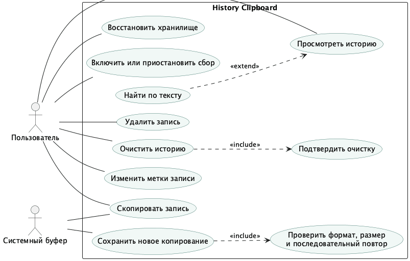
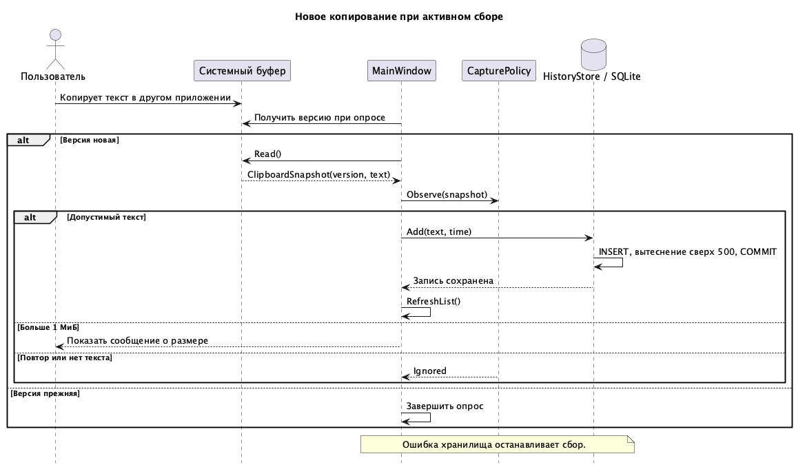
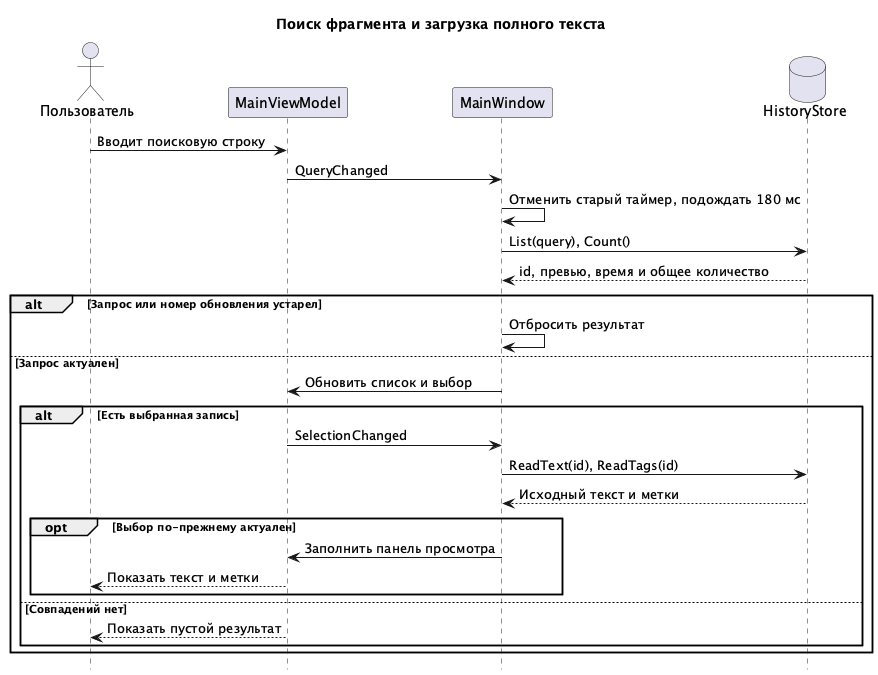
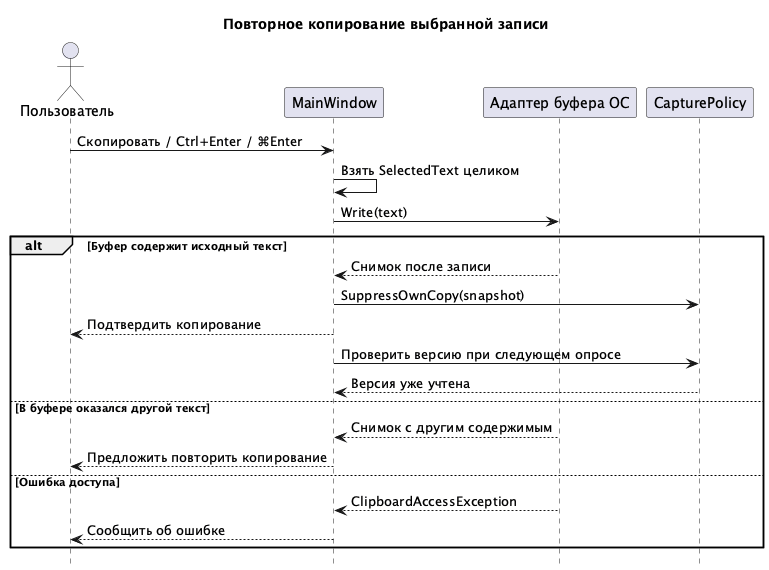
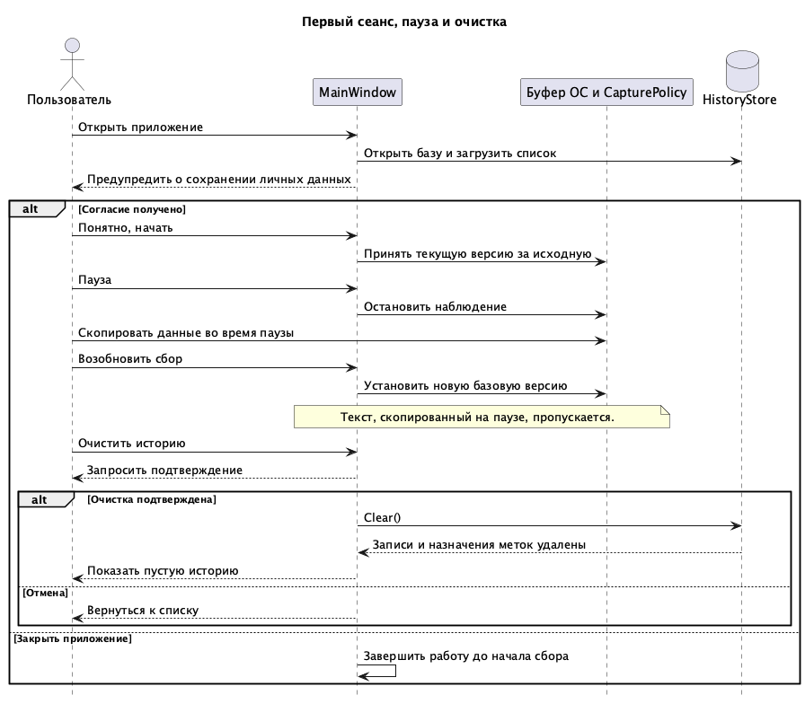

# Поведение History Clipboard

Пользователь просматривает и удаляет сохранённые фрагменты, назначает метки и управляет сбором. Второй актор — системный буфер обмена Windows или macOS. Он предоставляет новую версию и содержимое, а также принимает текст при повторном копировании. SQLite и правила отбора находятся внутри приложения.

## Варианты использования

Проверка нового содержимого обязательна при захвате. Очистка включает подтверждение. Поиск расширяет обычный просмотр, когда пользователь задаёт непустой запрос.



[Векторная версия](../use_case/use_case_diagram.svg) · [Исходник PlantUML](../use_case/use_case_diagram.puml)

## 1. Захват нового текста

Опрос сравнивает версию буфера с базовой. CapturePolicy отбрасывает пустой текст и соседние повторы. Только допустимый снимок попадает в транзакцию добавления и вытеснения старой записи.



[Векторная версия](sequence/capture.svg) · [Исходник PlantUML](sequence/capture.puml)

## 2. Поиск и выбор записи

После задержки в 180 мс HistoryStore возвращает превью и число записей. Счётчики версии запроса и выбора защищают интерфейс от запоздалого результата. Полный текст и метки загружаются для выбранной строки.



[Векторная версия](sequence/search.svg) · [Исходник PlantUML](sequence/search.puml)

## 3. Повторное копирование

Кнопка и сочетание клавиш передают адаптеру полный фрагмент, включая пробелы и переносы. Собственная запись считается обработанной только при совпадении прочитанного текста с отправленным.



[Векторная версия](sequence/copy.svg) · [Исходник PlantUML](sequence/copy.puml)

## 4. Сеанс с паузой и очисткой

После согласия пользователь приостанавливает сбор перед копированием личного текста. Возобновление устанавливает новую базовую версию. Отмена очистки оставляет историю доступной.



[Векторная версия](sequence/session.svg) · [Исходник PlantUML](sequence/session.puml)

## Обновление изображений

Из корня репозитория выполните команды для PlantUML 1.2025.10. Параметр smetana задан в исходниках тех диаграмм, которым требуется раскладка графа.

```sh
plantuml -charset UTF-8 -tpng docs/use_case/*.puml docs/behavior/sequence/*.puml docs/database/*.puml
plantuml -charset UTF-8 -tsvg docs/use_case/*.puml docs/behavior/sequence/*.puml docs/database/*.puml
```
