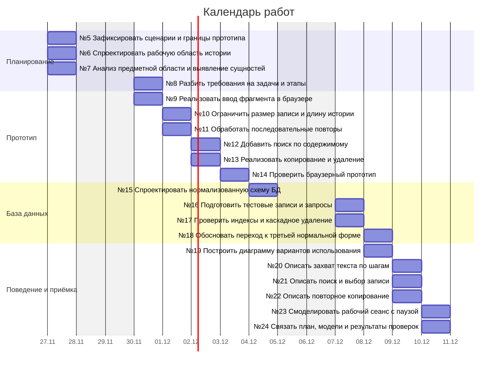

# План проекта History Clipboard

Учебный календарь охватывает четыре этапа доработки менеджера буфера обмена с 2026-11-27 по 2026-12-10. Это плановые сроки. Фактическое выполнение фиксируется отдельно датами слияния PR. Загрузка одного исполнителя ограничена шестью часами в рабочий день, выходные свободны.

[Диаграмма Ганта в GitHub Projects](https://github.com/users/Mizzzord/projects/3/views/2) · [Беклог и зависимости](https://github.com/Mizzzord/history-clipboard-srs/issues?q=is%3Aissue+assignee%3AMizzzord) · [Контрольные точки](https://github.com/Mizzzord/history-clipboard-srs/milestones?state=all)

## Участники и роли

Индивидуальный проект ведёт владелец репозитория. Одна основная роль назначена каждой задаче меткой.

| Роль | Исполнитель в GitHub | Ответственность |
| --- | --- | --- |
| Менеджер проекта | @Mizzzord | Декомпозиция, очерёдность, сроки и приёмка |
| Дизайнер | @Mizzzord | Компоновка рабочего экрана и сценарии взаимодействия |
| Разработчик ядра | @Mizzzord | SQLite, миграция данных, связи и хранение |
| Разработчик интерфейса | @Mizzzord | Ввод, поиск, просмотр и управление записями |
| Тестировщик | @Mizzzord | Граничные значения, обратимость операций и проверки платформ |

## Укрупнённый календарь

| Этап | Начало | Окончание | Задач | Часы |
| --- | --- | --- | ---: | ---: |
| Планирование | 2026-11-27 | 2026-11-30 | 4 | 9 |
| Браузерный прототип | 2026-11-30 | 2026-12-03 | 6 | 17 |
| Модель данных | 2026-12-04 | 2026-12-08 | 4 | 13 |
| Поведение и приёмка | 2026-12-08 | 2026-12-10 | 6 | 15 |

Всего 20 задач и 54 ч. По сложности: 5 малых, 14 средних, 1 крупная. Первые четыре исходные истории (#1–#4) описывают требования MVP и учитываются отдельно. Сначала проектируются ввод и структура данных, затем проверяются операции и связи, в конце согласуются диаграммы и документация.

## Диаграмма календарного плана

## Декомпозиция работ

| Задача в порядке выполнения | Роль | Оценка | Дата | Часы | Зависит от |
| --- | --- | --- | --- | ---: | --- |
| [#5 Зафиксировать сценарии и границы прототипа](https://github.com/Mizzzord/history-clipboard-srs/issues/5) | Менеджер проекта | small | 2026-11-27 | 1 | — |
| [#6 Спроектировать рабочую область истории](https://github.com/Mizzzord/history-clipboard-srs/issues/6) | Дизайнер | medium | 2026-11-27 | 3 | [#5](https://github.com/Mizzzord/history-clipboard-srs/issues/5) |
| [#7 Анализ предметной области и выявление сущностей](https://github.com/Mizzzord/history-clipboard-srs/issues/7) | Разработчик ядра | medium | 2026-11-27 | 2 | — |
| [#8 Разбить требования на задачи и этапы](https://github.com/Mizzzord/history-clipboard-srs/issues/8) | Менеджер проекта | medium | 2026-11-30 | 3 | — |
| [#9 Реализовать ввод фрагмента в браузере](https://github.com/Mizzzord/history-clipboard-srs/issues/9) | Разработчик интерфейса | medium | 2026-11-30 | 3 | [#5](https://github.com/Mizzzord/history-clipboard-srs/issues/5), [#6](https://github.com/Mizzzord/history-clipboard-srs/issues/6) |
| [#10 Ограничить размер записи и длину истории](https://github.com/Mizzzord/history-clipboard-srs/issues/10) | Разработчик интерфейса | medium | 2026-12-01 | 3 | [#9](https://github.com/Mizzzord/history-clipboard-srs/issues/9) |
| [#11 Обработать последовательные повторы](https://github.com/Mizzzord/history-clipboard-srs/issues/11) | Разработчик интерфейса | small | 2026-12-01 | 2 | [#9](https://github.com/Mizzzord/history-clipboard-srs/issues/9) |
| [#12 Добавить поиск по содержимому](https://github.com/Mizzzord/history-clipboard-srs/issues/12) | Разработчик интерфейса | medium | 2026-12-02 | 3 | [#9](https://github.com/Mizzzord/history-clipboard-srs/issues/9) |
| [#13 Реализовать копирование и удаление](https://github.com/Mizzzord/history-clipboard-srs/issues/13) | Разработчик интерфейса | medium | 2026-12-02 | 3 | [#9](https://github.com/Mizzzord/history-clipboard-srs/issues/9) |
| [#14 Проверить браузерный прототип](https://github.com/Mizzzord/history-clipboard-srs/issues/14) | Тестировщик | medium | 2026-12-03 | 3 | [#10](https://github.com/Mizzzord/history-clipboard-srs/issues/10), [#11](https://github.com/Mizzzord/history-clipboard-srs/issues/11), [#12](https://github.com/Mizzzord/history-clipboard-srs/issues/12), [#13](https://github.com/Mizzzord/history-clipboard-srs/issues/13) |
| [#15 Спроектировать нормализованную схему БД](https://github.com/Mizzzord/history-clipboard-srs/issues/15) | Разработчик ядра | large | 2026-12-04 | 5 | [#7](https://github.com/Mizzzord/history-clipboard-srs/issues/7) |
| [#16 Подготовить тестовые записи и запросы](https://github.com/Mizzzord/history-clipboard-srs/issues/16) | Разработчик ядра | small | 2026-12-07 | 2 | [#15](https://github.com/Mizzzord/history-clipboard-srs/issues/15) |
| [#17 Проверить индексы и каскадное удаление](https://github.com/Mizzzord/history-clipboard-srs/issues/17) | Тестировщик | medium | 2026-12-07 | 3 | [#15](https://github.com/Mizzzord/history-clipboard-srs/issues/15), [#16](https://github.com/Mizzzord/history-clipboard-srs/issues/16) |
| [#18 Обосновать переход к третьей нормальной форме](https://github.com/Mizzzord/history-clipboard-srs/issues/18) | Разработчик ядра | medium | 2026-12-08 | 3 | [#15](https://github.com/Mizzzord/history-clipboard-srs/issues/15) |
| [#19 Построить диаграмму вариантов использования](https://github.com/Mizzzord/history-clipboard-srs/issues/19) | Дизайнер | medium | 2026-12-08 | 3 | [#7](https://github.com/Mizzzord/history-clipboard-srs/issues/7) |
| [#20 Описать захват текста по шагам](https://github.com/Mizzzord/history-clipboard-srs/issues/20) | Разработчик ядра | medium | 2026-12-09 | 2 | [#19](https://github.com/Mizzzord/history-clipboard-srs/issues/19) |
| [#21 Описать поиск и выбор записи](https://github.com/Mizzzord/history-clipboard-srs/issues/21) | Разработчик интерфейса | small | 2026-12-09 | 2 | [#19](https://github.com/Mizzzord/history-clipboard-srs/issues/19) |
| [#22 Описать повторное копирование](https://github.com/Mizzzord/history-clipboard-srs/issues/22) | Тестировщик | small | 2026-12-09 | 2 | [#19](https://github.com/Mizzzord/history-clipboard-srs/issues/19) |
| [#23 Смоделировать рабочий сеанс с паузой](https://github.com/Mizzzord/history-clipboard-srs/issues/23) | Дизайнер | medium | 2026-12-10 | 3 | [#20](https://github.com/Mizzzord/history-clipboard-srs/issues/20), [#21](https://github.com/Mizzzord/history-clipboard-srs/issues/21), [#22](https://github.com/Mizzzord/history-clipboard-srs/issues/22) |
| [#24 Связать план, модели и результаты проверок](https://github.com/Mizzzord/history-clipboard-srs/issues/24) | Менеджер проекта | medium | 2026-12-10 | 3 | [#8](https://github.com/Mizzzord/history-clipboard-srs/issues/8), [#14](https://github.com/Mizzzord/history-clipboard-srs/issues/14), [#17](https://github.com/Mizzzord/history-clipboard-srs/issues/17), [#18](https://github.com/Mizzzord/history-clipboard-srs/issues/18), [#23](https://github.com/Mizzzord/history-clipboard-srs/issues/23) |
